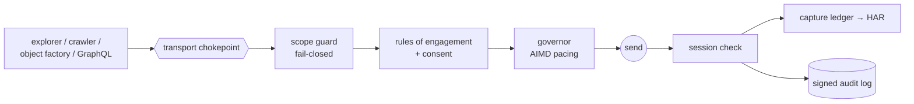

# Diamond Sword

[](https://github.com/NizarJasim1/diamond-sword/actions/workflows/ci.yml)    

Diamond Sword turns an authorized browsing session into evidence for authorization
testing. You log in by hand as each of your test accounts; Diamond Sword explores the
application, exercises what it finds, and records the traffic as multi-account HAR.
It then hands that capture to [IOLITE](https://github.com/NizarJasim1/iolite) for
surface mapping and to [ONYX](https://github.com/NizarJasim1/Onyx) for confirmation.

```
you log in (A, B, anon) ──▶ Diamond Sword explores + records ──▶ HAR
        ──▶ IOLITE (spec.json) ──▶ ONYX (state read-back) ──▶ report
```

It never decides whether something is a vulnerability. ONYX does that, and only with
proof.

---

## The problem it solves

Authorization testing needs the same surface captured as several different users.
Doing that by hand on a large single-page app means clicking through hundreds of
screens per account, and you still miss the routes you never thought to open.
Crawlers solve the volume but tend to be noisy, blind to app state, and easy to
point at things you are not allowed to touch.

Diamond Sword sits in between: thorough like a crawler, careful like a human, and
bounded by the program's scope at every request.

## How it covers a big application

- **Templates, not instances.** `/projects/17/issues/4` and `/projects/90/issues/12`
  are the same page. Fingerprinting collapses millions of URLs into a few hundred
  templates, and coverage is tracked per template.
- **Map first.** OpenAPI, GraphQL introspection, sitemaps and JS bundles seed the
  map before any clicking, so declared surface is covered even if the UI hides it.
- **Real interaction.** The explorer clicks, fills and submits the way a person
  would, guided by an optional playbook (flows to run first, areas to prioritise,
  buttons never to press).
- **Objects for both accounts.** For BOLA testing you need an object owned by A
  that B then tries to reach. The object factory creates those pairs through the
  app's own features, with minimal and reversible payloads.
- **GraphQL exercised as both users.** Introspection, selection of
  authorization-relevant operations, depth-bounded queries filled with real ids.
- **Self-healing.** A cascade of locator strategies, invariant checks and a
  recovery state machine keep a long run going when the DOM shifts, a modal appears,
  or a session expires. Everything is checkpointed, so a crashed run resumes where
  it stopped.

## Every request takes the same path



Nothing in the codebase sends traffic around this path, and every step can stop
the request.

## Safety is enforced in code

- **Scope guard, fail-closed.** Every request passes through one transport chokepoint
  that checks scope and rules of engagement first. Hostname tricks such as
  `api.target.example@evil.example` or `api.target.example.evil.example` are rejected,
  and out-of-scope entries always win over wildcards.
- **Humans handle logins and sensitive actions.** MFA, step-up auth and anything
  destructive go to a person. Destructive actions do not run even with auto-approve.
- **Read-only by default.** Any state change needs explicit consent, dry-run off,
  and a program that allows it.
- **Polite pacing.** Per-host AIMD rate control, `Retry-After` honoured, and a circuit
  breaker that stops the run if the target keeps blocking.
- **Signed audit log.** Every scope decision and action is written to a hash-chained
  ledger you can verify afterwards (`diamond_sword verify`).
- **No AI at runtime.** Crawling and capture are deterministic. A playbook can be
  written beforehand with help from an LLM, but the run itself only follows the frozen
  file.

## Quick start

The core is standard library only. Live capture needs Playwright (and optionally
mitmproxy) on your machine.

```bash
# check an engagement file parses and see what is in scope
python -m diamond_sword init fixtures/engagements/crapi.local.json

# crawl a local lab (OWASP crAPI) as one principal
python -m diamond_sword crawl fixtures/engagements/crapi.local.json \
    --start http://localhost:8888/ --max-pages 200

# full run: capture per principal → IOLITE → ONYX → report
# (principal_A.json holds the cookies/headers from your manual login as account A)
python -m diamond_sword pipe fixtures/engagements/crapi.local.json \
    --start http://localhost:8888/ \
    --principal A=principal_A.json --principal B=principal_B.json --principal anon \
    --audit audit.jsonl --coverage coverage.jsonl --har-dir ./har \
    --onyx-link /path/to/iolite/iolite/onyx_link.py \
    --out report.md

# interactive exploration with a playbook
python -m diamond_sword explore fixtures/engagements/crapi.local.json \
    --start http://localhost:8888/ --playbook fixtures/playbooks/crapi.local.playbook.json

# continue an interrupted run, then verify the signed audit log
python -m diamond_sword resume --coverage coverage.jsonl \
    --engagement fixtures/engagements/crapi.local.json --principal anon
python -m diamond_sword verify audit.jsonl
```

Without `--onyx-link`, `pipe` only crawls and writes HAR files, so you can run IOLITE
and ONYX yourself.

Start with a local lab. Detailed run guides (in Arabic) are in
[`docs/ar/RUNBOOK.md`](docs/ar/RUNBOOK.md) and [`docs/ar/INTERACTION.md`](docs/ar/INTERACTION.md).

## Engagement files

An engagement describes the program's scope the same way bug-bounty platforms do:

```json
{
  "program": "acmepay",
  "platform": "hackerone",
  "scope": {
    "in":  ["*.acmepay.example", "acmepay.example"],
    "out": ["docs.acmepay.example", "help.acmepay.example"],
    "out_classes": ["rate limiting without impact"]
  },
  "roe": {"read_only": true, "automation_permitted": true, "max_rps": 0.5}
}
```

Examples in [`fixtures/engagements/`](fixtures/engagements) use fictional programs.
Always copy scope and rules from the real program page, and set
`automation_permitted` only if the program actually allows it.

## Architecture

| package | job |
|---|---|
| `legal` | scope parsing, scope guard, rules of engagement, consent gate, audit ledger |
| `coverage` | map-first seeding, fingerprinting, templates, crawler, triage, principal manager, state graph |
| `interact` | element discovery, actions, action ledger, playbook direction, explorer |
| `live` | session liveness and re-auth, pacing governor, transport chokepoint, object factory, GraphQL exerciser |
| `heal` | locator cascade, invariants, recovery state machine, coverage ledger |
| `capture` | HAR model, sessions, Playwright and mitmproxy backends |
| `oracle` | question bus and answer application for anything the run couldn't resolve on its own |
| `pipeline` | IOLITE and ONYX bridges, typed findings, report, run conductor |
| `models` | optional offline helpers for writing playbooks; never in the run path |

The full design write-up (Arabic) is in [`docs/ar/ARCHITECTURE.md`](docs/ar/ARCHITECTURE.md).

## Testing

```bash
bash scripts/verify.sh
```

This byte-compiles everything, runs the unit tests, runs mutation testing on the
core modules (scope, rules of engagement, ledgers, coverage, healing, capture,
pipeline), and finishes with `ruff` and `mypy --strict`. Each mutation spec plants
deliberate bugs and the suite has to catch every one of them. CI runs the same
checks on Python 3.10 to 3.12.

## Responsible use

Use Diamond Sword only on applications you own, local labs such as
[OWASP crAPI](https://github.com/OWASP/crAPI), or programs whose written rules allow
automated testing with multiple accounts. See [`SECURITY.md`](SECURITY.md).

## License

Source-available under the [PolyForm Noncommercial License 1.0.0](LICENSE). Free for
research, learning and other noncommercial use. Commercial use needs a separate
license; reach out through [GitHub](https://github.com/NizarJasim1).

---

Built and maintained by **Nizar Jasim Mohammed Al-Zubaidi** ([@NizarJasim1](https://github.com/NizarJasim1)).
